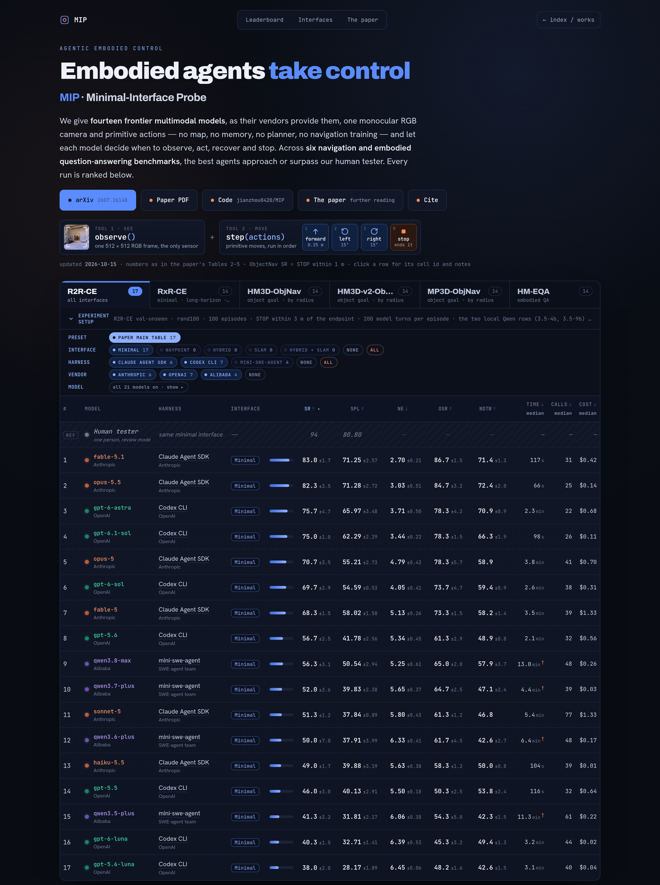
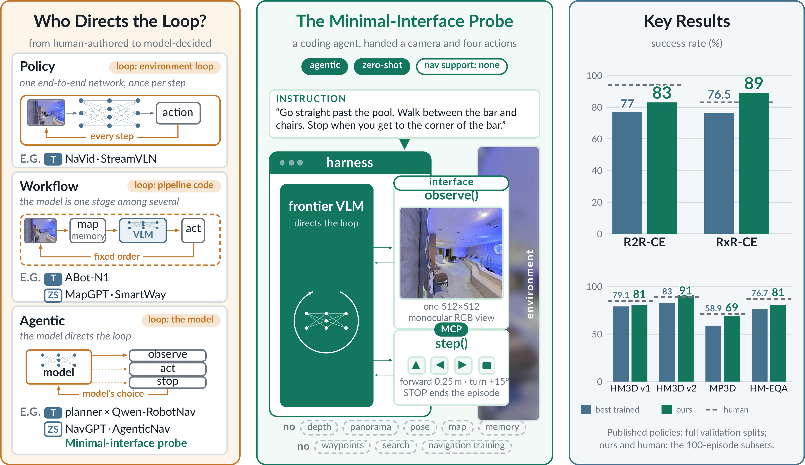

<div align="center">

# MIP

## Embodied Agents Take Control

### Minimal-Interface Zero-Shot Agents Rival Industrial-Scale Policies in Vision-and-Language Navigation

**Jian Zhou\* · Xunyi Zhao\* · Gengze Zhou · Zerui Li · Sihao Lin · Jiajun Liu · Qi Wu**

<p>
  <a href="https://arxiv.org/abs/2607.26148"></a>
  <a href="https://jianzhou0420.github.io/mip/"></a>
  <a href="#citation"></a>
</p>

</div>

## Leaderboard

Every model, benchmark, interface and harness, with the exact briefing each agent received:
**see the [leaderboard](https://jianzhou0420.github.io/mip/)**.

<a href="https://jianzhou0420.github.io/mip/"></a>

## Overview

<p align="center">
  
</p>

A frontier multimodal model gets two tools, `observe()` (one RGB frame) and `step(actions)` (forward,
turn, stop), and decides by itself when to look, move, recover and stop. With nothing else — no map, no
memory, no planner, no navigation training — the best agents reach **83%** success on R2R-CE, **89%** on
RxR-CE and **81%** on HM-EQA, ahead of the published results we compare against on all six benchmarks.

## Using this repository

**Install.** Two conda environments (the runner, and the simulator: habitat-sim 0.3.3 +
[EmbodiedScore-envs](https://github.com/jianzhou0420/EmbodiedScore-envs)), the Claude Code / Codex CLIs and
the datasets — step by step in [INSTALL.md](INSTALL.md).

**Run a cell.** One yaml per benchmark × interface (`mip/configs/experiments/std_mip_<benchmark>_<interface>.yaml`);
the command line picks the seat:

```
python runner.py std_mip_r2r_minimal harness=cc model=fable-5 +run.fake=true run.episodes=0   # wiring check, no tokens
python runner.py std_mip_r2r_minimal harness=cc model=fable-5                                 # R2R-CE, Minimal, Claude Agent SDK
python runner.py std_mip_hm3d_v2_minimal harness=codex model=gpt-6-astra                       # HM3D v2 ObjectNav, Codex CLI
python runner.py std_mip_r2r_hybrid_slam harness=mini model=opus-5                            # R2R-CE, Hybrid + SLAM, mini-SWE-agent
```

- `harness=` `cc` (Claude Agent SDK) · `codex` (Codex CLI) · `mini` (mini-SWE-agent); `model=` a row of
  `mip/configs/models/models.yaml`; `effort=` the vendor's word (`default` sends nothing).
- Cells: `std_mip_{r2r,rxr,hm3d,hm3d_v2,mp3d,hmeqa}_minimal` and `std_mip_r2r_{waypoint,hybrid,slam,hybrid_slam}`.
  The Waypoint and Hybrid cells need the waypoint predictor service, the SLAM cells docker (INSTALL.md § 6).
- Every run writes `outputs/<harness>/<run name>/`: per-episode event logs, every frame the model saw, the
  harness's raw stream, cost, and a copy of the code. `python -m ui.server` shows them in a browser.
- [`scripts/mip_paper_cells.sh`](scripts/mip_paper_cells.sh) lists the runner lines behind each table of the paper.

**Splits.** Every number in the paper is measured on a 100-episode subset of the official validation
split; the files are in [`splits/`](splits), at the path each would have next to the official files:

| Benchmark | Subset | File |
|---|---|---|
| R2R-CE | `rand100` (OpenNav's subset of val_unseen) | `splits/vlnce/R2R_VLNCE_v1-3_preprocessed/rand100/` |
| RxR-CE | `mip100` (English val_unseen) | `splits/vlnce/RxR_VLNCE_v0/mip100/` |
| HM3D v1 ObjectNav | `mip100` | `splits/objectnav/hm3d/v1/mip100/` |
| HM3D v2 ObjectNav | `mip100` | `splits/objectnav/hm3d/v2/mip100/` |
| MP3D ObjectNav | `mip100` | `splits/objectnav/mp3d/v1/mip100/` |
| HM-EQA | `mip100` | `splits/hmeqa/questions_mip100.json` |

A `mip100` subset is a fixed function of the official files: per scene, a share of 100 by largest
remainder, filled with the episodes whose SHA-256 of `"mip100:{scene}:{id}"` is smallest. No random
generator is involved, so anyone with the official files can draw the same subset again. R2R-CE
`rand100` is not ours: it is the 100-episode subset released by OpenNav (OpenNav-100, also used by SmartWay),
with every episode and its ground truth replaced verbatim from the official val_unseen files.
`splits/manifests/` lists every chosen episode with its scene and id (and, for `mip100`, its hash);
`r2r_val_unseen_rand100.json` records the OpenNav subset's position in the official file. The runner reads
its own copy of the split files from the EmbodiedScore-envs package (`embodiedscore_envs/splits/`, which
also has the generator and the full provenance table); the two copies are byte-identical.

**Layout.** `runner.py` is the entry point; everything else lives in `mip/`: `core/` (run loop, MCP bridge,
env server, recorders), `harnesses/`, `tools/` (nav · waypoint · slam), `prompts/`, `configs/`, `envs/`.

## Citation

```bibtex
@article{zhou2026mip,
  title   = {Embodied Agents Take Control: Minimal-Interface Zero-Shot Agents Rival Industrial-Scale Policies in Vision-and-Language Navigation},
  author  = {Zhou, Jian and Zhao, Xunyi and Zhou, Gengze and Li, Zerui and Lin, Sihao and Liu, Jiajun and Wu, Qi},
  journal = {arXiv preprint arXiv:2607.26148},
  year    = {2026}
}
```

Jian Zhou and Xunyi Zhao contributed equally.

## License

MIT, see [LICENSE](LICENSE). The scene datasets are licensed separately by their owners.
